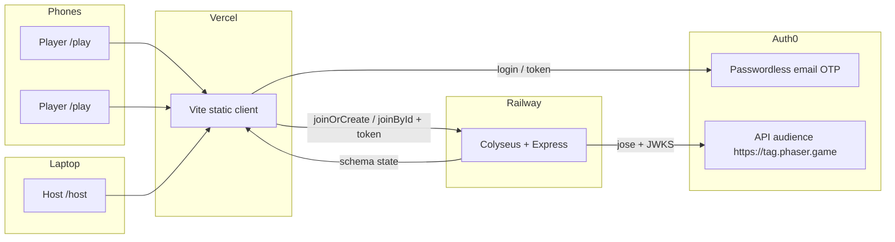

# Phaser Colyseus Tag

A reusable multiplayer **tag** starter: phones are controllers, a laptop is the
host arena, and a [Colyseus](https://colyseus.io) server owns the game. The
client is **Vite + vanilla TypeScript + Phaser 4** (never Next.js). Auth is
**Auth0 passwordless**. This repo is Focus Otter's personal starter — another
agent will later fork it for a conference talk and add [OpenFGA](https://openfga.dev)
rule checks plus host controls that change rules mid-game.

```
pnpm dev          # server :2567 + client :5173
# laptop  → http://localhost:5173/host
# phones  → scan the QR (or /play?room=<id>)
```

## What it is

- **Host screen** (`/host`, laptop, login required): creates a room, shows a QR
  code for `/play?room=<id>`, a live player list, and Start. During the round it
  renders the full map, every player, who is *it*, and the countdown. At the end
  it shows results.
- **Player screen** (`/play?room=…`, phone, login required): joins with an
  editable nickname (from the Auth0 profile), a portrait-friendly virtual
  joystick, and a simple view of *you* plus `"You're IT!"` and the timer.
  Page scroll/zoom are disabled.
- **Rules** (server-authoritative, 2-minute round):
  - one map, a handful of obstacles
  - one random player starts as *it*
  - touching another player passes *it*
  - ~1.5s tag-back immunity on both players
  - winner = **least total time spent as *it***
  - disconnects can reconnect; if *it* leaves, the room reassigns

Clients send input only. The server simulates a fixed tick and broadcasts
Colyseus schema state.

## Architecture



| Piece | Path | Notes |
| --- | --- | --- |
| Client | `client/` | Vite MPA: `index.html`, `host.html`, `play.html` |
| Server | `server/` | Colyseus room `tag`, `/health`, CORS, WebSockets |
| Shared constants | `shared/` | map, default rules, message names |
| Phaser skills | `.cursor/skills/` | Official skills from `phaserjs/phaser` |
| Tag decisions | `server/src/rules/canTag.ts` | **Single hook** for later OpenFGA |
| Live rules | `TagRoomState.rules` | Patchable mid-game once `allowLiveRuleChanges` is on |

## Extension points (for the OpenFGA talk)

Two places are intentionally obvious:

1. **`canTag(tagger, target, room)`** in [`server/src/rules/canTag.ts`](server/src/rules/canTag.ts).
   Every tag in the sim loop goes through this function. Drop an OpenFGA
   `check()` here (and keep the local immunity / distance / `rules.allowTag`
   tests). Do not add extra tag permission branches in `TagRoom`.
2. **`state.rules`** on the synced room state ([`server/src/rooms/schema.ts`](server/src/rooms/schema.ts)).
   Host message `setRule` is already wired and **disabled** until
   `rules.allowLiveRuleChanges === true`. The later agent can flip that flag
   from a host control and authorize each key with OpenFGA.

## Local development

Requires Node 22+ and [pnpm](https://pnpm.io) 10.

```bash
corepack enable
pnpm install
cp client/.env.example client/.env
cp server/.env.example server/.env
# fill Auth0 + Colyseus values (see below)
pnpm dev
```

One command runs **both** packages (`@tag/server` on `:2567`, `@tag/client` on
`:5173`).

Dev-only join tokens (`dev:<id>:<nickname>`) are accepted when
`ALLOW_DEV_TOKENS=true` and `NODE_ENV` is not `production`. The client shows a
**Dev guest** button in Vite dev, and `?devName=Alice` auto-signs a guest so
Playwright / the sim script can drive the UI without Auth0.

```bash
pnpm sim    # 3 headless players: join, start, tag, timer
```

## Environment variables

### Client (`client/.env`, also Vercel)

| Name | Purpose |
| --- | --- |
| `VITE_AUTH0_DOMAIN` | Tenant host, no `https://` |
| `VITE_AUTH0_CLIENT_ID` | SPA application client id |
| `VITE_AUTH0_AUDIENCE` | API identifier (`https://tag.phaser.game`) |
| `VITE_AUTH0_CONNECTION` | Passwordless connection name (`email`) |
| `VITE_COLYSEUS_URL` | Game server (`http://localhost:2567` locally) |

### Server (`server/.env`, also Railway)

| Name | Purpose |
| --- | --- |
| `PORT` | Listen port (Railway sets this) |
| `AUTH0_DOMAIN` | Same tenant host as the client |
| `AUTH0_AUDIENCE` | Same API identifier |
| `CORS_ORIGIN` | Comma-separated browser origins. `*.vercel.app` allowed |
| `ALLOW_DEV_TOKENS` | `true` only on local / CI — **never** in production |
| `NODE_ENV` | `production` disables the `dev:` token path |

## Auth0 setup

This starter already has a tenant app + API on Focus Otter's Auth0 tenant.
Recreate them on a new tenant like this (Auth0 CLI, **not** the Auth0 MCP):

```bash
# Install: https://github.com/auth0/auth0-cli#installation
# Sandbox / agent login (keep this copy step):
export AUTH0_CLI_AUTH_MODE=env
export AUTH0_DOMAIN="$AUTH0_CLI_DOMAIN"
export AUTH0_CLIENT_ID="$AUTH0_CLI_CLIENT_ID"
export AUTH0_CLIENT_SECRET="$AUTH0_CLI_CLIENT_SECRET"

auth0 apps create --name "Phaser Colyseus Tag" --type spa --auth-method None \
  --callbacks "http://localhost:5173,https://<vercel-app>.vercel.app" \
  --logout-urls "http://localhost:5173,https://<vercel-app>.vercel.app" \
  --origins "http://localhost:5173,https://<vercel-app>.vercel.app" \
  --web-origins "http://localhost:5173,https://<vercel-app>.vercel.app"

auth0 apis create --name "Phaser Colyseus Tag API" \
  --identifier "https://tag.phaser.game" --offline-access

# SMS passwordless needs a phone provider (Twilio). This tenant had none, so
# the starter uses email passwordless instead:
auth0 connections create --data '{"name":"email","strategy":"email"}'
auth0 connections enabled-clients update <email-connection-id> \
  --data '[{"client_id":"<spa-client-id>","status":true}]'
auth0 api patch prompts --data '{"identifier_first":true}'
```

Add every Vercel preview + production origin to **Allowed Callback URLs**,
**Allowed Logout URLs**, and **Allowed Web Origins**. The client always uses
`redirect_uri = window.location.origin` and restores `appState.returnTo`.

The game client is `@auth0/auth0-spa-js`. It requests an access token for
`https://tag.phaser.game` and passes it as `{ token }` to
`client.create` / `client.joinById`. The server verifies that JWT with
`jose` against the tenant JWKS (`iss` + `aud`). Unauthenticated joins are
rejected.

**Passwordless status:** SMS could not be enabled — Auth0 returned
`No phone provider configured for the tenant`. Email passwordless is enabled
for the SPA. This tenant also has **no email provider** (SendGrid / SES / …),
so OTP emails will not actually send until one is configured in
Branding → Email Provider. Local play uses the `dev:` token path.

Current tenant resources (ids are public):

| Resource | Name | Id |
| --- | --- | --- |
| SPA | Phaser Colyseus Tag | `oGqXJ1wuK8dWqH67rhCPMWfPaafJKDvW` |
| API | Phaser Colyseus Tag API | audience `https://tag.phaser.game` |
| Connection | `email` (passwordless) | `con_0WvjaM39JQMbgb0I` |

## Deploy

### Client → Vercel (Git-linked)

The Vercel project is created with the MCP `create_git_project` helper, root
directory `client/`, so every PR gets a preview.

Required project env vars (Production + Preview):

- `VITE_AUTH0_DOMAIN`
- `VITE_AUTH0_CLIENT_ID`
- `VITE_AUTH0_AUDIENCE`
- `VITE_AUTH0_CONNECTION=email`
- `VITE_COLYSEUS_URL` — the Railway public URL (`https://….up.railway.app`)

Then add the preview/prod origins on the Auth0 SPA.

### Server → Railway (Hobby)

This repo is ready for `railway up` from the repository root. The Dockerfile
is `server/Dockerfile`; `railway.toml` / `server/railway.json` set the
`/health` check.

```bash
# One-time, from a machine with Railway credentials:
npm i -g @railway/cli
railway login
railway init          # or railway link
railway variables set AUTH0_DOMAIN=<tenant>.auth0.com
railway variables set AUTH0_AUDIENCE=https://tag.phaser.game
railway variables set CORS_ORIGIN=https://<vercel-app>.vercel.app,https://*.vercel.app
railway variables set NODE_ENV=production
railway up
```

Copy the resulting public HTTPS URL into Vercel as `VITE_COLYSEUS_URL`.
WebSockets work on Railway without extra config as long as the service is not
forced to HTTP/2-only edge caching; the Colyseus transport shares the Express
HTTP server.

If `RAILWAY_TOKEN` is present in CI, the same `railway up` flow can run
non-interactively (`railway login` is skipped; `RAILWAY_TOKEN` is enough).

## How to fork / extend

1. Fork the repo. Keep the `client/` + `server/` + `shared/` split.
2. Point Auth0 callbacks at your own SPA (or clone this one).
3. Put authorization in **`canTag()`** — not in the Phaser scenes, not in extra
   room `if` branches.
4. Host rule UI should write `state.rules` (enable `allowLiveRuleChanges` first).
5. Do not add Neon, Sentry, or analytics in this spike; keep it a thin starter.
6. Art: Kenney CC0 only. Record new packs in `CREDITS.md`.

## Scripts

| Command | What |
| --- | --- |
| `pnpm dev` | Client + server together |
| `pnpm --filter @tag/client build` | Vite production build |
| `pnpm sim` | Headless 3-player tag + timer check |

No automated unit test suite — this is a spike. `pnpm sim` is the verification.
